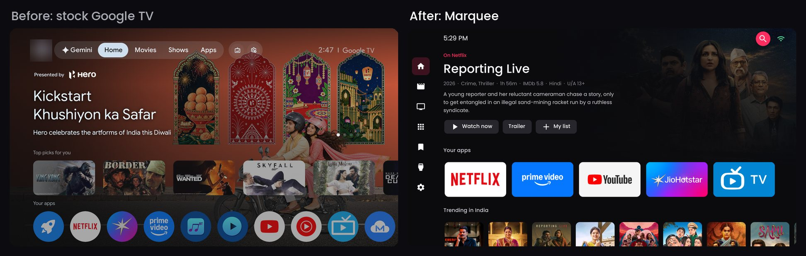
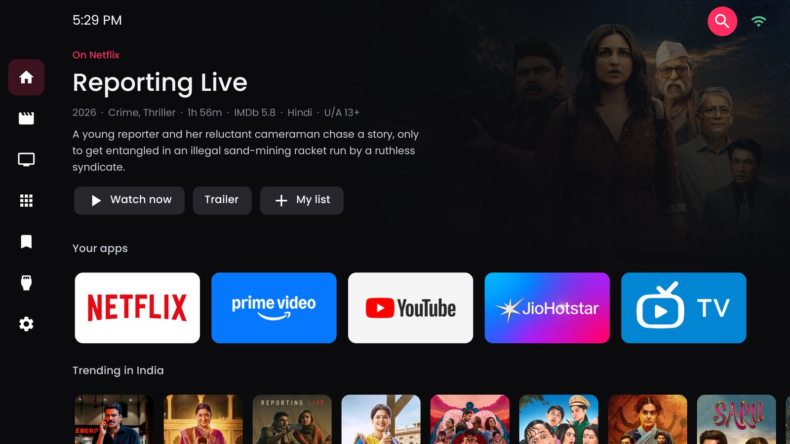
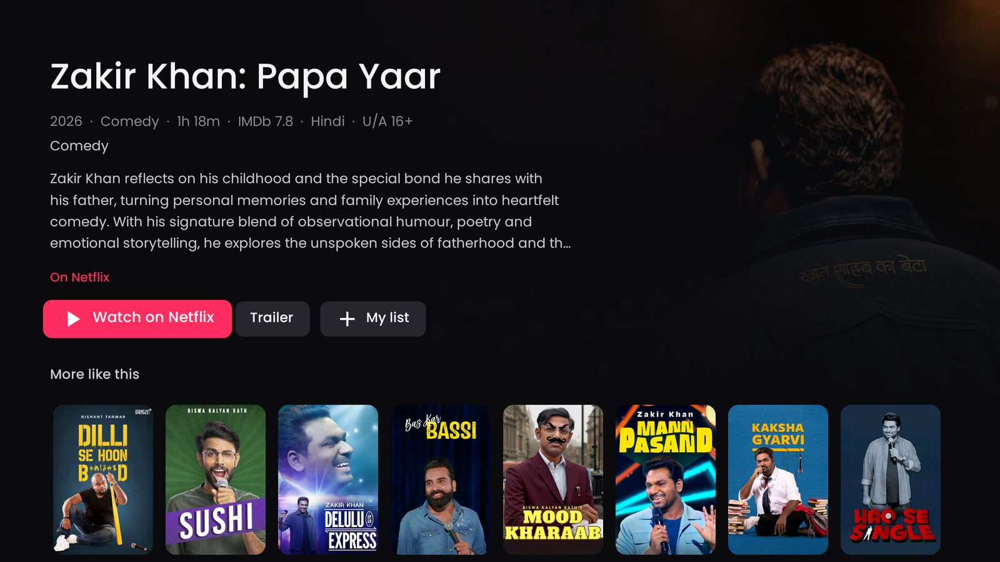
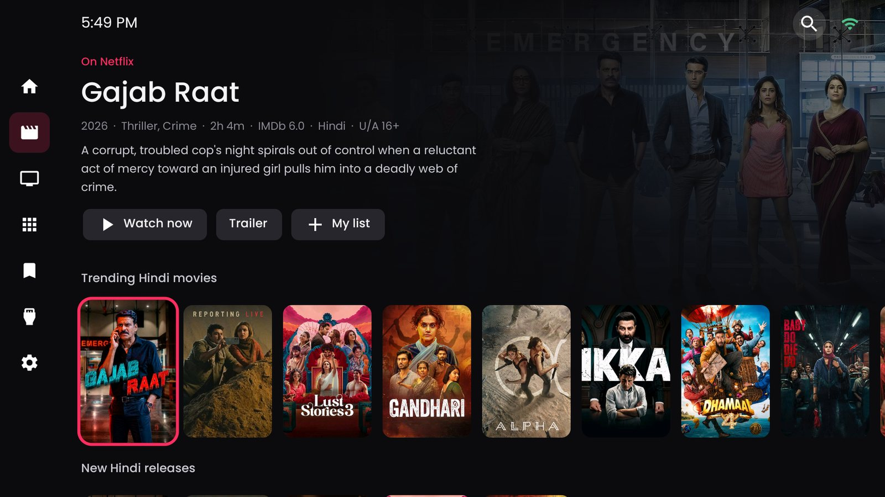
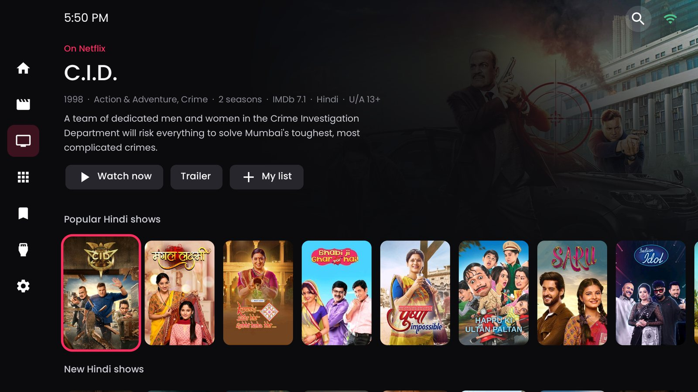
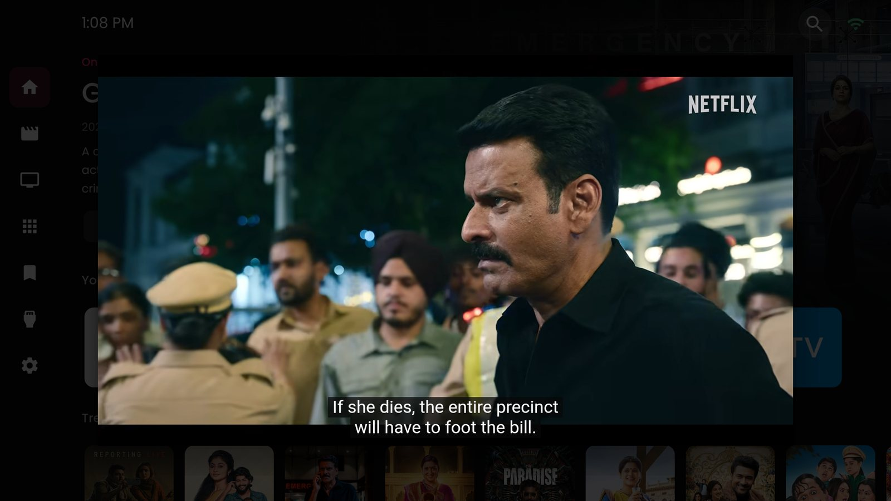
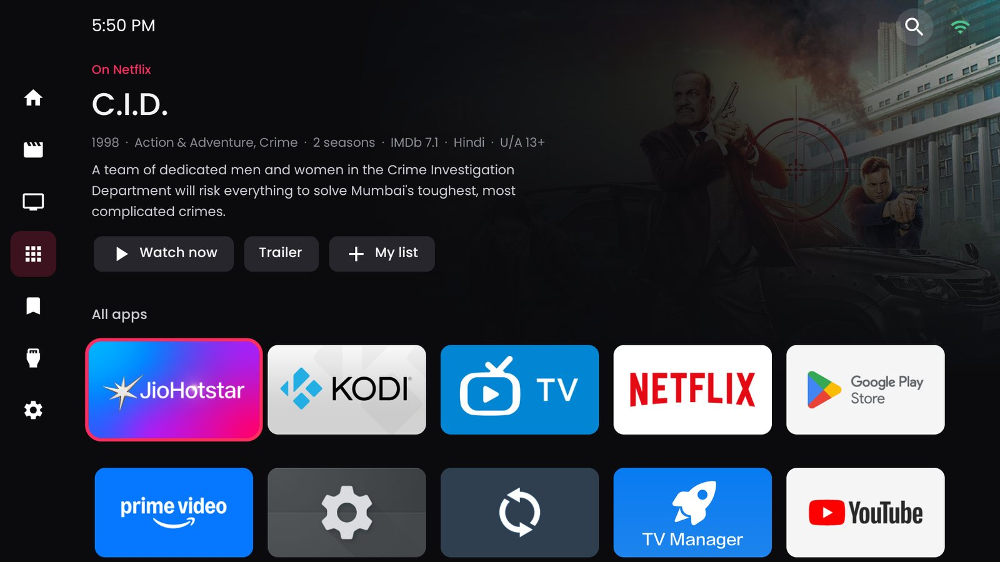
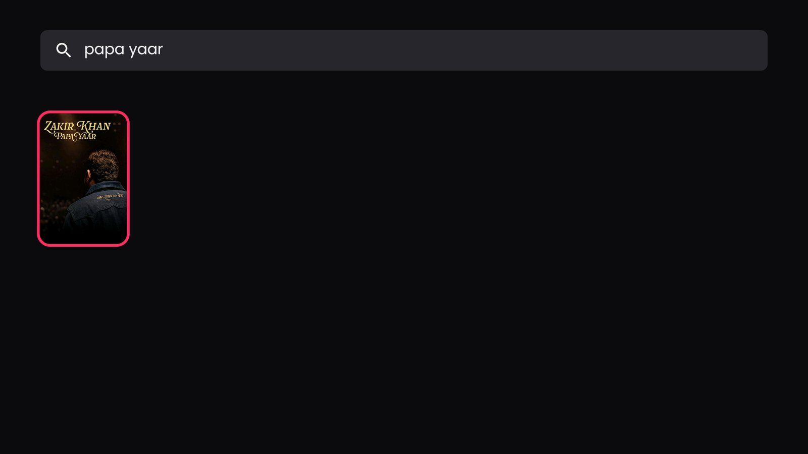
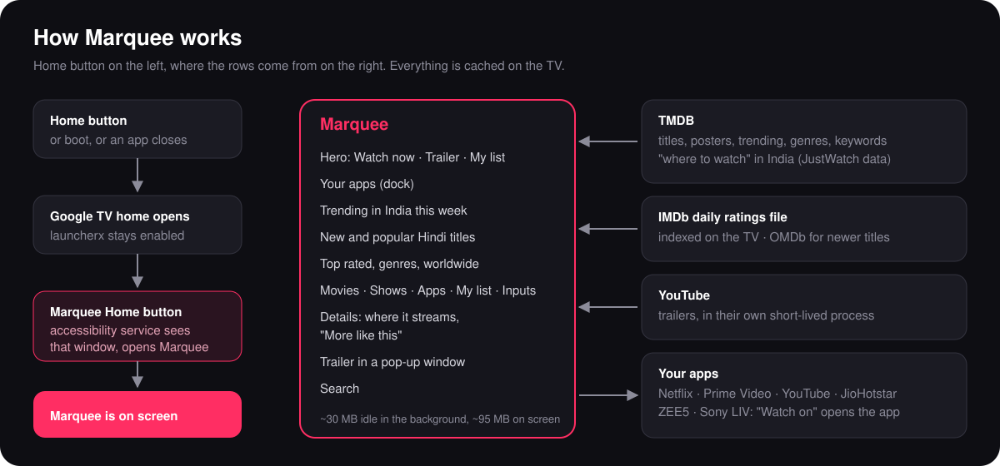
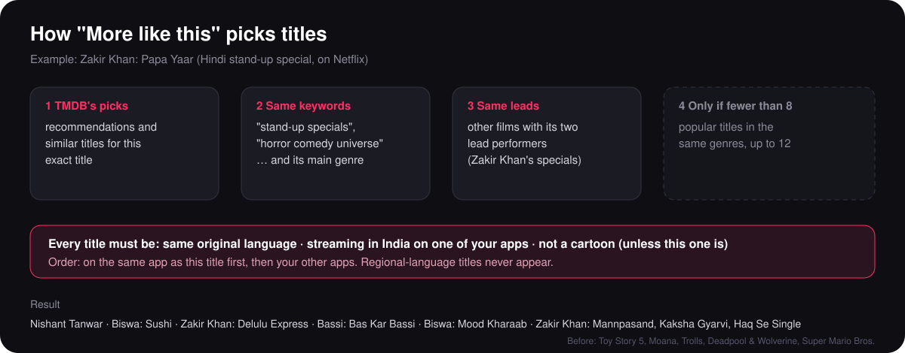

# Marquee TV

Debloat your Android TV or Google TV safely, and give it a clean, poster-first home screen that only
recommends what you can actually watch, on the streaming apps you already have.



Marquee TV builds on [cleanyourtv](https://github.com/Gathin23/cleanyourtv), which does the careful ADB work
(backups, safety checks, disabling, restore). This repo adds:

- **Marquee**, a home-screen app with posters, trailers, IMDb ratings and "where to watch".
- **Scripts** to debloat with your own list, install Marquee, check the TV and undo everything.
- **[PROMPT.md](PROMPT.md)**, a prompt that lets an AI coding agent (Claude Code, Codex, Gemini CLI) do the
  whole job on your TV, asking you before anything that depends on your household.
- **Worked examples** from real TVs in [examples/](examples/).

## What you get

- **A home screen without ads.** No sponsored banners and no "Top picks" from apps you don't have. The hero and
  every row come from what's trending in your country this week.
- **Only your apps.** Every poster is streaming in your country on one of your apps, on subscription, free or
  with ads. "Watch on Netflix" opens Netflix with that title already searched.
- **Your language first.** The main rows can favour one language (Marquee ships set to India and Hindi; see
  [docs/CUSTOMISE.md](docs/CUSTOMISE.md) to change region, language and services).
- **IMDb ratings, and only IMDb.** From IMDb's daily ratings file, indexed on the TV; OMDb fills in titles too
  new for the file. No rating rather than a different site's score.
- **Trailers in a window.** Trailer opens a floating YouTube player; Back returns you to the same spot.
- **"More like this" that makes sense.** Same language, same kind of title, and on your apps (see below).
- **A lighter TV.** Telemetry, OEM demo apps and things you don't use are disabled. Optional AdGuard DNS blocks
  ads for every app on the TV.
- **Fully undoable.** Nothing is uninstalled. One script puts everything back.

## Screenshots

| Home | Details and "More like this" |
|---|---|
|  |  |
| **Movies** | **Shows** |
|  |  |
| **Trailer pop-up** | **All apps** |
|  |  |

Search shows a poster grid as you type:



## Will it work on my TV?

| Part | Works on |
|---|---|
| Debloat (scripts + cleanyourtv) | Android TV and Google TV sets with ADB: Sony, TCL, Hisense, Xiaomi, Philips, Acer, OnePlus, Nvidia Shield and most others. Not Samsung Tizen, LG webOS or Fire TV. |
| Marquee | Android 8.0 (API 26) or newer. Home-button takeover is built for the Google TV launcher (`com.google.android.apps.tv.launcherx`). |
| Scripts | Windows PowerShell. On macOS and Linux, run the same `tools/tv.py` commands they use. |

Every TV has different bloat, so you make (or reuse) a debloat list for your model. cleanyourtv already has
[lists for many TVs](https://github.com/Gathin23/cleanyourtv/tree/main/examples), and this repo's lists use
the same format. [docs/DEBLOAT.md](docs/DEBLOAT.md) explains how to build one.

## How Marquee works



On many Google TV sets you can't simply replace the stock home screen: disabling the stock launcher or its
setup app can break Wi-Fi or boot. So both stay enabled. Marquee runs a tiny accessibility service that watches
for one thing, the stock home window appearing, and opens Marquee instead. It never reads the screen's
content and never intercepts keys, so volume and other buttons work as before.

Some TVs have a "close apps" or memory-cleaner button that force-stops every app, which switches that service
off. Marquee is granted `WRITE_SECURE_SETTINGS` over ADB so it can switch its service back on the next time it
starts. When the service reconnects it checks whether the stock home is on screen, and only then takes over,
so it never pulls you out of something you're watching.

### "More like this"



TMDB's own "similar" list is often unrelated (for a Hindi stand-up special it returned Toy Story 5, Moana and
Super Mario). Marquee builds the row from TMDB's recommendations, shared keywords and the same lead performers,
keeps only titles in the same language that stream on your apps, and puts those on the same app first.

## Do it yourself

Two ways: give [PROMPT.md](PROMPT.md) to an AI coding agent and let it do the work while asking you the
questions, or follow these steps.

### Before you start

1. **On the TV:** open Settings → System (or Device Preferences) → About, and press OK on "Build" or "Android
   TV OS build" 7 times. Then in Developer options turn on **USB debugging**, and **Network debugging** if
   your TV lists it separately. Note the TV's IP address from its network settings.
2. **On the PC**, put cleanyourtv and this repo side by side:
   ```
   some-folder\
     cleanyourtv\    git clone https://github.com/Gathin23/cleanyourtv
     marquee-tv\     git clone https://github.com/kunalchauhan1992/marquee-tv
   ```
   Then set up cleanyourtv's Python ADB client once:
   ```powershell
   cd cleanyourtv
   python -m venv tools\venv
   tools\venv\Scripts\python.exe -m pip install -r tools\requirements.txt
   $env:TV_HOST = '192.168.1.50'      # your TV's IP
   tools\venv\Scripts\python.exe tools\tv.py --probe
   ```
   Accept the "Allow USB debugging?" prompt on the TV (tick "Always allow").
3. **To build Marquee:** JDK 17 and the Android SDK (platform 34, build-tools 34), with `JAVA_HOME` and
   `ANDROID_HOME` set. Android Studio installs both.
4. **API keys** (free):
   - **TMDB:** create an account at [themoviedb.org](https://www.themoviedb.org/settings/api), request an API
     key for personal use, and copy the 32-character **API Key** (not the long Read Access Token) into
     `keys\tmdb-key.txt`.
   - **OMDb** (optional, ratings for very new titles): get a free key at
     [omdbapi.com](https://www.omdbapi.com/apikey.aspx), click the activation link in the email, and put the
     key in `keys\omdb-key.txt`.

   The `keys` folder is in `.gitignore`. Never commit, paste or screenshot your keys.

### Steps

```powershell
cd marquee-tv
# 1. Back up first (PROMPT.md, "Back up").
# 2. Make your debloat list: start from cleanyourtv's list for your TV, or one in examples\.
#    Put it in a folder of your own, e.g. my-tv\debloat.txt, and comment out anything your household uses.
.\scripts\apply-debloat.ps1 -TvHost 192.168.1.50 -List my-tv\debloat.txt -AdGuardDns
# 3. Build and install Marquee, then send the keys (and your dock: the apps in the first row)
.\scripts\install-marquee.ps1 -TvHost 192.168.1.50
.\scripts\send-keys.ps1 -TvHost 192.168.1.50 -Dock com.netflix.ninja,com.google.android.youtube.tv
# 4. Restart the TV once, then check
.\scripts\check.ps1 -TvHost 192.168.1.50 -List my-tv\debloat.txt
```

`check.ps1` prints a line per check, `OK` or `FIX`:

```
OK   Marquee Home-button service        bound=1
OK   On screen                          com.marquee.tvhome/com.marquee.tvhome.MainActivity
OK   Debloated apps running             none of 31
OK   Private DNS                        dns.adguard-dns.com
OK   Free RAM                           865 MB of 1851 MB
OK   Marquee memory                     101 MB
```

Then press Home on the **real remote**, from inside an app. An injected key press doesn't prove the
accessibility service works.

### When you're done: close ADB

Network ADB has no password or encryption. Turn off USB debugging (and network debugging) in Developer options,
revoke USB debugging authorisations, restart the TV, and check the port is closed:

```powershell
..\cleanyourtv\tools\venv\Scripts\python.exe ..\cleanyourtv\tools\adb-closed.py 192.168.1.50
```

Turn it back on only when you want to update Marquee or change something.

### Undo

```powershell
.\scripts\restore.ps1 -TvHost 192.168.1.50 -List my-tv\debloat.txt                  # everything except Marquee
.\scripts\restore.ps1 -TvHost 192.168.1.50 -List my-tv\debloat.txt -RemoveMarquee   # and uninstall Marquee
.\scripts\restore.ps1 -TvHost 192.168.1.50 -Package com.example.app                 # bring back one app
```

## Examples

| TV | Board | Android | Notes |
|---|---|---|---|
| [Acer AR50QDXGU2875AT](examples/acer-r10g/) (50" QLED, India) | MOKA R10G, Realtek | 14 | 31 disabled; firmware re-enables 15 at boot, handled with background restrictions |

Tried it on another TV? Add a folder to `examples/` with your `debloat.txt`, a `reenabled-at-boot.txt` if your
firmware needs one, and a short README. Leave out IP addresses, Wi-Fi names, account names and serial numbers.

## Privacy and permissions

Marquee has no analytics, ads or accounts. It talks to:

| Where | What for | What it sends |
|---|---|---|
| api.themoviedb.org, image.tmdb.org | titles, posters, where to watch | your TMDB key, the titles it looks up |
| datasets.imdbws.com | IMDb's ratings file, once a day | nothing |
| www.omdbapi.com (optional) | ratings for titles newer than the file | your OMDb key, an IMDb id |
| youtube.com (trailer window only) | the trailer | what YouTube embeds normally see |

| Permission | Why |
|---|---|
| `INTERNET`, `ACCESS_NETWORK_STATE` | the rows above; retry when the network comes back after boot |
| Accessibility service | to see when the stock home window opens, and on reconnect which app is on screen. It reads nothing else and filters no keys. |
| `WRITE_SECURE_SETTINGS` (granted over ADB) | to switch its own service back on after a "close apps" cleaner |

Keys reach the TV only from the PC's ADB shell: Marquee's setup receiver needs the `DUMP` permission, which no
installed app has.

## Known limits

- **Some firmware turns apps back on at boot.** Disabling doesn't stick for those; a background restriction does
  (see [docs/DEBLOAT.md](docs/DEBLOAT.md)). Persistent system apps keep running whatever you do, short of root.
- **Where-to-watch data comes from JustWatch through TMDB** and is sometimes a day or two behind.
- **Region, language and services are set in code** for now ([docs/CUSTOMISE.md](docs/CUSTOMISE.md)).
- **The Home takeover targets the Google TV launcher.** Other launchers need their package name in
  `HomeRedirectService.java` and `res/xml/home_redirect_service.xml`.

More fixes in [docs/TROUBLESHOOTING.md](docs/TROUBLESHOOTING.md).

## Credits and licences

- Marquee and the scripts: [MIT](LICENSE).
- [cleanyourtv](https://github.com/Gathin23/cleanyourtv) (MIT) for the ADB client, the safety rules and some icons.
- [Poppins](https://fonts.google.com/specimen/Poppins) font, SIL Open Font License ([marquee/FONT-LICENSE-POPPINS-OFL.txt](marquee/FONT-LICENSE-POPPINS-OFL.txt)).
- This product uses the TMDB API but is not endorsed or certified by TMDB.
- Information courtesy of IMDb (https://www.imdb.com). Used with permission. IMDb's datasets are for personal,
  non-commercial use only.
- Posters and stills in the screenshots belong to their owners and are shown only to illustrate the UI.
- Not affiliated with Google, any TV maker or any streaming service.
