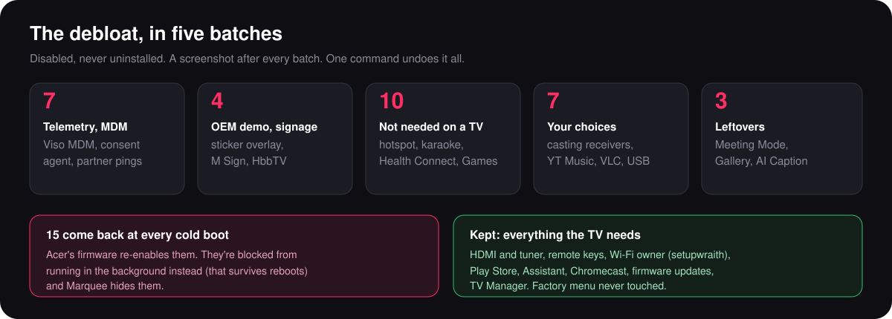

# Acer AR50QDXGU2875AT (MOKA R10G)

50" QLED Google TV sold in India. MOKA R10G board, Realtek RT2875P, about 1.85 GB RAM, Android 14
(build UKR1.260612.001). Tested on two sets, October 2026.



| File | What |
|---|---|
| [debloat.txt](debloat.txt) | 31 packages in five batches, each with its reason |
| [reenabled-at-boot.txt](reenabled-at-boot.txt) | the 15 the firmware turns back on at every cold boot |

```powershell
.\scripts\apply-debloat.ps1 -TvHost <tv ip> -List examples\acer-r10g\debloat.txt -AdGuardDns
.\scripts\check.ps1 -TvHost <tv ip> -List examples\acer-r10g\debloat.txt -Persistent com.mk.tv.meeting.service
```

The general method is in [docs/DEBLOAT.md](../../docs/DEBLOAT.md). Below is what's specific to this board.

## The boot problem

On this board, a cold boot (power off at the wall, or a restart) turns 15 of the disabled packages back on.
`lastDisabledCaller` shows `com.realtek.systemservice`, and the trigger is a factory-mode check in the
firmware that only root could change.

Disabling them again after every boot would need something running at boot with system permissions. Instead,
`apply-debloat.ps1` reads `reenabled-at-boot.txt` and gives each one a background restriction:

```
cmd appops set <package> RUN_ANY_IN_BACKGROUND ignore
```

That setting survives reboots. The apps are enabled but can't start services or receive broadcasts in the
background, so after a cold boot only one of them runs:

| Package | After a cold boot |
|---|---|
| `com.mk.tv.meeting.service` | runs, about 55 MB. It's a **persistent** system app (`PERSISTENT` flag, system uid), so Android restarts it whatever you do. |
| the other 14 | don't start |

Marquee hides all 15 from its Apps page by default (`Prefs.DEFAULT_HIDDEN`).

Viso MDM and its companion (`com.viso.mdm`, `com.usc.scmanager.moka`) look like they come back too, because
`pm list packages -d` stops listing them. They don't: the firmware *hides* them as well as leaving them
disabled (`enabled=3 hidden=true` in `dumpsys package`), and `pm list` leaves hidden packages out.

## What was kept, and why

| Kept | Why |
|---|---|
| `launcherx` (Google TV home) | Marquee takes the Home button with an accessibility service instead of disabling it. Disabling the stock launcher on this board risks a boot into its recovery activity. |
| `setupwraith` | It owns the saved Wi-Fi network here (`dumpsys wifi \| grep cname`). Disabling it drops Wi-Fi and with it ADB. |
| `com.realtek.tv`, `.tv.passthrough`, `.dtv`, `.tv.atv` | Live TV and the HDMI inputs. |
| `com.realtek.dtmb`, `.tv.isdb`, `.tv.atsc` | Tuner apps for other countries, but they're TV input services: removing one can break the input list. |
| `com.apps.mk.sk`, `fivekey`, `virtualkey`, `globalkeyhandler`, `bluetoothremote` | Remote keys and pairing. |
| `com.apps.ota`, `com.apps.authota`, `com.realsil.ota` | Firmware updates. |
| `com.apps.tvmanager` | TV Manager. Its "close apps" button force-stops Marquee too, which Marquee recovers from (see the main README). |
| Assistant (`katniss`), Chromecast (`mediashell`), Gboard | Used in the household. |
| Android ad services (`adservices`, `ondevicepersonalization`, `federatedcompute`) | Turned back on while testing voice search; harmless with AdGuard DNS. |
| `com.apps.factory.ui` | The factory menu. Never started, never disabled. |

## Results

Measured with `scripts\check.ps1` and `dumpsys meminfo` after a cold boot, October 2026:

- 31 packages disabled, 15 restricted, 1 still running (the persistent signage service).
- About 900 MB of 1.85 GB RAM available at idle on Marquee's home screen.
- Marquee: opens in 1.3 s from cold, about 95 MB while on screen, about 30 MB in the background.
- Storage: 6.5 GB of 9.5 GB free.
